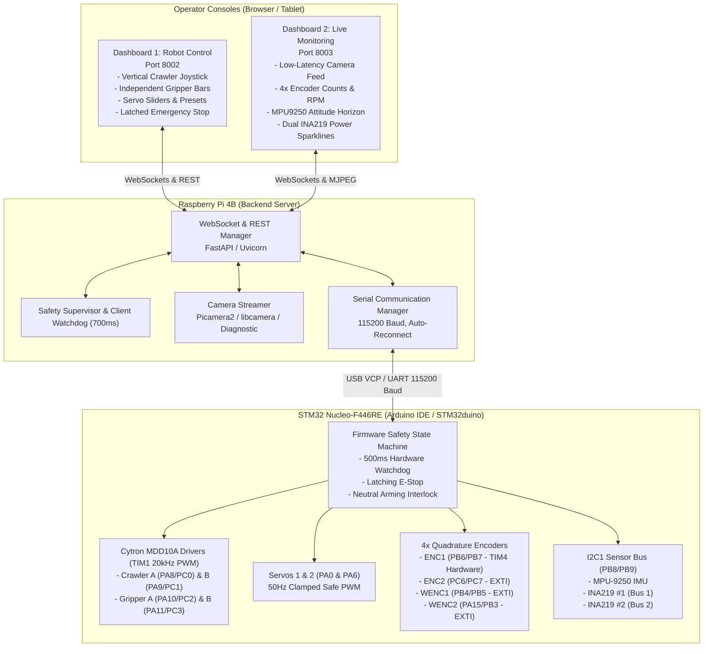

# IIT Mandi Power Line Inspection Crawler Robot

A complete, production-grade, modular software and firmware system engineered for the **IIT Mandi Power Line Inspection Crawler Robot**.

The system features real hardware integration with the **STM32 Nucleo-F446RE**, high-rate bidirectional serial communication, dual **Cytron MDD10A** motor drivers, 4-channel quadrature encoder feedback, **MPU-9250** 9-DoF IMU telemetry, dual **INA219** bus power monitors, live camera streaming, and two separate high-performance web dashboards hosted on a **Raspberry Pi 4B**.

---

## 1. System Architecture



---

## 2. Hardware Pinout Reference (Authoritative Netlist)

Sourced directly from `STM32_Nucleo_F446RE_GPIO_Named_Connection_Sheet.xlsx`:

| Subsystem | Signal Name | MCU Pin | Nucleo Connector | Description |
|---|---|---|---|---|
| **Crawler Motor A** | `CRAWL_A_PWM` / `DIR` | **PA8** / **PC0** | CN10-23 / CN7-38 | Cytron MDD10A Driver 1 (TIM1_CH1 20kHz) |
| **Crawler Motor B** | `CRAWL_B_PWM` / `DIR` | **PA9** / **PC1** | CN10-21 / CN7-36 | Cytron MDD10A Driver 1 (TIM1_CH2 20kHz, Inverted) |
| **Gripper Motor A** | `GRIP_A_PWM` / `DIR`  | **PA10** / **PC2**| CN10-33 / CN7-35 | Cytron MDD10A Driver 2 (TIM1_CH3 20kHz) |
| **Gripper Motor B** | `GRIP_B_PWM` / `DIR`  | **PA11** / **PC3**| CN10-14 / CN7-37 | Cytron MDD10A Driver 2 (TIM1_CH4 20kHz) |
| **Servo 1**         | `SERVO_1_PWM`        | **PA0**           | CN7-28           | 50Hz PWM (TIM2/TIM5) safe angle clamped |
| **Servo 2**         | `SERVO_2_PWM`        | **PA6**           | CN10-13          | 50Hz PWM (TIM3/TIM13) safe angle clamped |
| **I2C Bus**         | `I2C_SCL` / `SDA`    | **PB8** / **PB9** | CN10-3 / CN10-5  | I2C1 Bus (MPU9250 + Dual INA219, 10k pullups) |
| **Encoder 1**       | `ENC1_A` / `B`       | **PB6** / **PB7** | CN10-17 / CN7-21 | **TIM4 Hardware Timer Encoder Mode (AF02)** |
| **Encoder 2**       | `ENC2_A` / `B`       | **PC6** / **PC7** | CN10-4 / CN10-19 | EXTI6 / EXTI7 Edge Interrupt Decoding |
| **Wheel Encoder 1** | `WENC1_A` / `B`      | **PB4** / **PB5** | CN10-27 / CN10-29| EXTI4 / EXTI5 Edge Interrupt Decoding |
| **Wheel Encoder 2** | `WENC2_A` / `B`      | **PA15** / **PB3**| CN7-17 / CN10-31 | EXTI15 / EXTI3 Edge Interrupt Decoding |
| **RPi UART**        | `PI_UART_RX` / `TX`  | **PA2** / **PA3** | CN10-35 / CN10-37| USART2 Hardware Serial (Optional to USB VCP) |

---

## 3. Dedicated Dashboards & Ports

### Dashboard 1: Robot Control
- **Port:** `8002`
- **URL:** `http://<RASPBERRY_PI_IP>:8002`
- **Features:**
  - **Large Vertical Joystick:** Smooth proportional crawler control (-100% to +100%). Pushing forward drives both motors forward; pushing down drives both backward. Auto-springs to zero on release. Touchscreen and mouse supported.
  - **Independent Gripper Speed Bars:** Gripper Motor A and Gripper Motor B have individual horizontal bars with center zero, auto-spring-back, and dedicated emergency stop buttons.
  - **Servo Angle Sliders:** Direct degree control with safe angle clamping (10° to 170°), center presets, and disable toggles.
  - **Master Emergency Stop Button:** Large, high-visibility button. Latches shutdown in firmware. Requires explicit reset button and neutral controls to re-arm.

### Dashboard 2: Live Monitoring & Diagnostics
- **Port:** `8003`
- **URL:** `http://<RASPBERRY_PI_IP>:8003`
- **Features:**
  - **Live Camera Stream:** Low-latency MJPEG feed (`/video_feed`) with auto-detected backend (Picamera2 / OpenCV / Diagnostic Pattern) and start/stop controls.
  - **Motor & Encoder Telemetry:** Real-time commanded speeds, raw counts, and RPM for all 4 encoders (shows "UNCALIBRATED (CPR=0)" until configured).
  - **MPU-9250 IMU Display:** Accelerometer (m/s²), Gyroscope (°/s), Temperature (°C), and dynamic 2D artificial horizon attitude indicator.
  - **Dual INA219 Power Monitors:** Live bus voltage, current, and wattage with scrolling sparkline history graphs.
  - **Diagnostics:** STM32 connection state, packet throughput (Hz), dropped packet counter, and detected I2C address map.

---

## 4. Multi-Layer Safety Architecture

1. **Firmware Command Watchdog (500 ms):** Stops all 4 DC motors (PWM = 0) if valid control commands cease arriving. Does NOT restart automatically.
2. **Host Client Watchdog (700 ms):** Zeroes motor commands if the web browser disconnects or the Wi-Fi connection drops.
3. **Firmware Emergency Stop Latch:** Overrides all speed commands. Cannot be cleared by motion inputs; requires a deliberate `reset_estop` command.
4. **Arming Neutral Interlock:** The robot cannot be armed while any control is displaced from neutral (0 speed).
5. **Opposite-End Inversion:** Crawler Motor B is inverted by default to ensure synchronized forward travel for opposite-facing motors.

---

## 5. Quick Start Guide

### 5.1 Flashing the STM32 Nucleo-F446RE
1. Open **Arduino IDE**.
2. Open `final_robot/firmware/STM32_Robot_Controller/STM32_Robot_Controller.ino`.
3. Select Board: `Nucleo-64` -> `Nucleo F446RE`.
4. Connect the Nucleo via USB and click **Upload**.

### 5.2 Running the Backend on Raspberry Pi 4B
```bash
# Automated setup
cd final_robot
bash scripts/install_pi.sh

# Start the servers
bash scripts/start_robot.sh
```

### 5.3 Running on Windows / Testing with Mock STM32
```bash
cd final_robot
# Run automated test suite
pytest tests -v

# Run backend servers
python run_robot.py
```
Open your browser to:
- Control: `http://localhost:8002`
- Monitoring: `http://localhost:8003`

---

## 6. Directory Structure

```
final_robot/
├── firmware/
│   └── STM32_Robot_Controller/
│       ├── STM32_Robot_Controller.ino      # Main Arduino sketch
│       ├── PinDefinitions.h                # Authoritative PCB pin mapping
│       ├── Config.h                        # Tunables, timings, safe limits
│       ├── MotorManager.h / .cpp           # Cytron MDD10A sign-magnitude PWM+DIR
│       ├── ServoManager.h / .cpp           # Servo 1 & 2 safe angle controller
│       ├── EncoderManager.h / .cpp         # 4-channel quadrature & TIM4 hardware
│       ├── SensorManager.h / .cpp          # MPU9250 IMU & Dual INA219 monitors
│       ├── SafetyWatchdog.h / .cpp         # Watchdog timer & E-stop latch
│       ├── CommsManager.h / .cpp           # Fast zero-heap JSON protocol
│       └── README.md                       # STM32 compilation guide
├── backend/
│   ├── config.yaml / config.py             # System configuration
│   ├── serial_manager.py                   # Threaded serial manager & auto-reconnect
│   ├── motor_controller.py                 # Crawler mapping & gripper controls
│   ├── telemetry_parser.py                 # Telemetry validator & health store
│   ├── safety_manager.py                   # Host watchdog & client tracker
│   ├── camera_streamer.py                  # Low-latency MJPEG camera engine
│   ├── websocket_manager.py                # 20Hz live telemetry broadcaster
│   ├── server_control.py                   # FastAPI app on port 8002
│   ├── server_monitor.py                   # FastAPI app on port 8003
│   └── main.py                             # Unified multi-service runner
├── frontend/
│   ├── control/                            # Dashboard 1 assets (Port 8002)
│   │   ├── index.html                      # Control console UI
│   │   ├── css/style.css                   # Dark industrial cyberpunk theme
│   │   └── js/                             # Joystick, gripper, and servo scripts
│   └── monitor/                            # Dashboard 2 assets (Port 8003)
│       ├── index.html                      # Telemetry & diagnostics UI
│       ├── css/style.css                   # Telemetry dashboard theme
│       └── js/                             # Attitude horizon, sparklines, app
├── scripts/
│   ├── install_pi.sh                       # One-click Raspberry Pi installer
│   ├── setup_systemd.sh                    # Systemd service installer
│   ├── start_robot.sh                      # Linux launcher
│   ├── start_robot.bat                     # Windows launcher
│   └── 99-stm32-nucleo.rules               # Udev rule for /dev/robot_stm32
├── tests/
│   ├── mock_stm32.py                       # Full STM32 hardware emulator
│   ├── test_protocol.py                    # Protocol unit tests
│   ├── test_safety.py                      # Watchdog & E-stop tests
│   └── test_backend.py                     # REST endpoint tests
├── docs/
│   ├── HARDWARE_PINOUT.md                  # Complete netlist & timer allocation
│   ├── COMMUNICATION_PROTOCOL.md           # Full JSON schemas & examples
│   ├── SAFETY_MANUAL.md                    # Safety procedures & guidelines
│   └── RASPBERRY_PI_SETUP.md               # OS, camera, and serial setup
├── run_robot.py                            # Top-level system launcher
└── requirements.txt                        # Python dependencies
```
