# IIT Mandi Power Line Inspection Crawler Robot - System Block Diagram

This document provides a publication-quality **System Architecture & Hardware Block Diagram** for inclusion in academic, project, or technical evaluation reports for the **IIT Mandi Power Line Inspection Crawler Robot**.

---

## 1. High-Level Engineering Block Diagram

```mermaid
flowchart TD
    %% Styling Definitions
    classDef pwr fill:#ffebee,stroke:#c62828,stroke-width:2px,color:#b71c1c;
    classDef mcu fill:#e3f2fd,stroke:#1565c0,stroke-width:2px,color:#0d47a1;
    classDef rpi fill:#e8f5e9,stroke:#2e7d32,stroke-width:2px,color:#1b5e20;
    classDef act fill:#fff3e0,stroke:#e65100,stroke-width:2px,color:#bf360c;
    classDef sns fill:#f3e5f5,stroke:#6a1b9a,stroke-width:2px,color:#4a148c;
    classDef ui  fill:#e0f7fa,stroke:#00838f,stroke-width:2px,color:#006064;

    %% -------------------------------------------------------------
    %% 1. Power Distribution Domain
    %% -------------------------------------------------------------
    subgraph POWER ["POWER DISTRIBUTION SYSTEM"]
        BAT["12V High-Discharge LiPo Battery"]:::pwr
        BUCK["Step-Down Buck Regulator<br/>12V DC &rarr; 5V DC (3A)"]:::pwr
        INA_MOT["INA219 #2 (Addr 0x41)<br/>Motor Bus Monitor (12V)"]:::pwr
        INA_LOG["INA219 #1 (Addr 0x40)<br/>Logic Bus Monitor (5V)"]:::pwr

        BAT ==>|"12V Unregulated"| INA_MOT
        BAT ==>|"12V Input"| BUCK
        BUCK ==>|"5V Regulated"| INA_LOG
    end

    %% -------------------------------------------------------------
    %% 2. Processing & Compute Architecture
    %% -------------------------------------------------------------
    subgraph PROCESSING ["DUAL-TIER PROCESSING HIERARCHY"]
        subgraph SBC ["High-Level Host: Raspberry Pi 4B"]
            RPI_CORE["Broadcom BCM2711<br/>Quad-Core Cortex-A72 @ 1.5GHz"]:::rpi
            API["FastAPI / Uvicorn ASGI Server<br/>WebSockets & REST Engine"]:::rpi
            STREAMER["Picamera2 Streamer<br/>MJPEG Video Pipeline (25 FPS)"]:::rpi
            SUPERVISOR["Safety Supervisor<br/>700ms Client Watchdog"]:::rpi
        end

        subgraph MCU ["Low-Level Controller: STM32 Nucleo-F446RE"]
            STM_CORE["ARM Cortex-M4 @ 180MHz<br/>512KB Flash / 128KB SRAM"]:::mcu
            TIM1["Timer 1 (Advanced TIM1)<br/>4-Channel 20kHz Silent PWM"]:::mcu
            TIM4["Timer 4 (General TIM4)<br/>Hardware Quadrature Decoder AF02"]:::mcu
            EXTI["EXTI Controller<br/>Interrupt Lines 3, 4, 5, 6, 7, 15"]:::mcu
            I2C1["I2C1 Peripheral<br/>100kHz Standard Mode (PB8/PB9)"]:::mcu
            WDOG["Hardware Watchdog (IWDG)<br/>500ms Hardware Fail-Safe"]:::mcu
        end
    end

    %% -------------------------------------------------------------
    %% 3. Actuation Subsystem
    %% -------------------------------------------------------------
    subgraph ACTUATORS ["ACTUATION & MOTOR DRIVE"]
        subgraph DRV1 ["Cytron MDD10A #1 (Locomotion)"]
            MOT_CA["Crawler Motor A<br/>Rhino 12V 300 RPM<br/>(60:1 x 3.6:1 = 216:1)"]:::act
            MOT_CB["Crawler Motor B<br/>Rhino 12V 300 RPM<br/>(60:1 x 3.6:1 = 216:1)"]:::act
        end

        subgraph DRV2 ["Cytron MDD10A #2 (Gripper Mechanism)"]
            MOT_GA["Gripper Motor A<br/>Rhino 12V 100 RPM<br/>(174:1 Planetary)"]:::act
            MOT_GB["Gripper Motor B<br/>Rhino 12V 100 RPM<br/>(174:1 Planetary)"]:::act
        end

        subgraph SERVOS ["Inspection Servos"]
            SRV1["Servo 1 (Joint A)<br/>50Hz Safe Clamped PWM"]:::act
            SRV2["Servo 2 (Joint B)<br/>50Hz Safe Clamped PWM"]:::act
        end
    end

    %% -------------------------------------------------------------
    %% 4. Telemetry & Sensory Feedback
    %% -------------------------------------------------------------
    subgraph SENSORS ["SENSORS & FEEDBACK SUBSYSTEM"]
        CAM["RPi Camera Module (v2/v3)<br/>2-Lane MIPI CSI Optical Sensor"]:::sns
        IMU["MPU-9250 9-DoF IMU (0x68)<br/>3-Axis Accel + Gyro + Temp"]:::sns
        ENC1["Encoder 1 (Crawler A)<br/>13 PPR Quad &rarr; 11,232 CPR"]:::sns
        ENC2["Encoder 2 (Crawler B)<br/>13 PPR Quad &rarr; 11,232 CPR"]:::sns
        WENC1["Encoder 3 (Gripper A)<br/>13 PPR Quad &rarr; 9,048 CPR"]:::sns
        WENC2["Encoder 4 (Gripper B)<br/>13 PPR Quad &rarr; 9,048 CPR"]:::sns
    end

    %% -------------------------------------------------------------
    %% 5. Operator Ground Station
    %% -------------------------------------------------------------
    subgraph GCS ["OPERATOR CONTROL & MONITORING CONSOLES"]
        D1["Dashboard 1: Robot Control Console (Port 8002)<br/>- Vertical Crawler Drive Stick<br/>- Independent Gripper Speed Bars<br/>- Servo Angles & Latching Emergency Stop"]:::ui
        D2["Dashboard 2: Live Monitoring & Diagnostics (Port 8003)<br/>- Real-time Optical Inspection MJPEG Feed<br/>- 4-Channel RPM & Position Telemetry<br/>- MPU9250 Artificial Horizon & Dual INA219 Power"]:::ui
    end

    %% =============================================================
    %% Interconnection Lines & Signal Buses
    %% =============================================================

    %% Power distribution feeds
    INA_MOT ==>|"12V Motor Rail"| DRV1
    INA_MOT ==>|"12V Motor Rail"| DRV2
    INA_LOG ==>|"5V Clean Rail"| SBC
    INA_LOG ==>|"5V Clean Rail"| MCU
    INA_LOG ==>|"5V Clean Rail"| SERVOS

    %% Communication between Host and Microcontroller
    RPI_CORE <-->|"USB VCP / UART Link<br/>115200 Baud (8N1)"| STM_CORE

    %% Camera feed
    CAM -->|"MIPI CSI Ribbon"| STREAMER

    %% I2C Bus connections
    I2C1 <-->|"I2C Bus (PB8/PB9 - 100kHz)"| IMU
    I2C1 <-->|"I2C Bus (PB8/PB9)"| INA_LOG
    I2C1 <-->|"I2C Bus (PB8/PB9)"| INA_MOT

    %% Motor Drive Control
    TIM1 -->|"PWM PA8 (20kHz)"| MOT_CA
    STM_CORE -->|"DIR PC0"| MOT_CA
    TIM1 -->|"PWM PA9 (20kHz)"| MOT_CB
    STM_CORE -->|"DIR PC1 (Inv)"| MOT_CB
    TIM1 -->|"PWM PA10 (20kHz)"| MOT_GA
    STM_CORE -->|"DIR PC2"| MOT_GA
    TIM1 -->|"PWM PA11 (20kHz)"| MOT_GB
    STM_CORE -->|"DIR PC3"| MOT_GB

    %% Servo Control
    STM_CORE -->|"TIM2/5 PA0 (50Hz)"| SRV1
    STM_CORE -->|"TIM3/13 PA6 (50Hz)"| SRV2

    %% Encoder Feedback
    ENC1 -->|"Hardware Ch A/B (PB6/PB7)"| TIM4
    ENC2 -->|"Ch A/B (PC6/PC7)"| EXTI
    WENC1 -->|"Ch A/B (PB4/PB5)"| EXTI
    WENC2 -->|"Ch A/B (PA15/PB3)"| EXTI

    %% Telemetry & Control to Ground Station
    API <-->|"Wi-Fi 802.11ac (WebSockets 20Hz & REST)"| D1
    API <-->|"Wi-Fi 802.11ac (WebSockets 20Hz)"| D2
    STREAMER -->|"HTTP MJPEG Stream (640x480 @ 25 FPS)"| D2
```

---

## 2. Hardware Subsystems Breakdown (For Report Inclusion)

### 2.1 Power Distribution Architecture
The robot operates from a single high-discharge **12V Lithium-Polymer (LiPo) Battery**:
1. **12V High-Current Rail:** Feeds the two **Cytron MDD10A** dual-channel motor drivers via an **INA219** current/voltage monitor (Address `0x41`). This domain handles instantaneous motor current spikes without affecting logic circuits.
2. **5V Regulated Logic Rail:** Stepped down via a high-efficiency DC-DC buck converter. Monitored by a dedicated **INA219** (Address `0x40`) to measure logic consumption, powering the Raspberry Pi 4B, STM32 Nucleo-F446RE, servos, and I2C sensors.

### 2.2 Dual-Tier Processing & Control
* **Tier 1 — High-Level SBC (Raspberry Pi 4B):**
  - Runs Linux OS with an asynchronous **FastAPI / Uvicorn** engine.
  - Serves **Dashboard 1 (Port 8002)** for robot steering and **Dashboard 2 (Port 8003)** for live telemetry and camera streaming.
  - Hosts a **Picamera2** low-latency MJPEG streaming pipeline yielding 25 FPS at 640&times;480 resolution.
  - Executes a 700ms client watchdog and pushes instant system-boot alerts to mobile devices via **ntfy.sh**.
* **Tier 2 — Low-Level Real-Time Controller (STM32 Nucleo-F446RE):**
  - ARM Cortex-M4 running at 180 MHz with hardware FPU.
  - Dedicated **Advanced Timer TIM1** generating 4 synchronized channels of 20 kHz silent PWM.
  - Hardware **Timer TIM4** in hardware encoder decoding mode (`AF02`) to track high-speed encoder pulses without CPU overhead.
  - An autonomous 500ms hardware watchdog that drives all actuators to a neutral state upon any serial communication drop.

### 2.3 Actuators & Motor Driver Interface
| Actuator Name | Motor Model | Driver / Channel | MCU PWM Pin | MCU DIR Pin | Reduction Ratio | Feedback Mechanism |
|---|---|---|---|---|---|---|
| **Crawler Motor A** | Robokits Rhino IG32 300 RPM | Cytron MDD10A #1 (CH1) | `PA8` (TIM1_CH1) | `PC0` | $216:1$ ($60 \times 3.6$) | ENC1 (`PB6`/`PB7` TIM4 Hardware) |
| **Crawler Motor B** | Robokits Rhino IG32 300 RPM | Cytron MDD10A #1 (CH2) | `PA9` (TIM1_CH2) | `PC1` (Inverted) | $216:1$ ($60 \times 3.6$) | ENC2 (`PC6`/`PC7` EXTI) |
| **Gripper Motor A** | Robokits Rhino IG32 100 RPM | Cytron MDD10A #2 (CH1) | `PA10` (TIM1_CH3) | `PC2` | $174:1$ Planetary | WENC1 (`PB4`/`PB5` EXTI) |
| **Gripper Motor B** | Robokits Rhino IG32 100 RPM | Cytron MDD10A #2 (CH2) | `PA11` (TIM1_CH4) | `PC3` | $174:1$ Planetary | WENC2 (`PA15`/`PB3` EXTI) |
| **Servo 1** | Standard RC Micro Servo | Direct MCU Header JP1 | `PA0` (TIM2/TIM5) | N/A | Direct | Open-loop safe clamp ($10^\circ - 170^\circ$) |
| **Servo 2** | Standard RC Micro Servo | Direct MCU Header JP1 | `PA6` (TIM3/TIM13) | N/A | Direct | Open-loop safe clamp ($10^\circ - 170^\circ$) |

### 2.4 Sensor & Telemetry Netlist
* **I2C Bus 1 (`PB8` SCL, `PB9` SDA @ 100 kHz, 10k&Omega; pullups):**
  - **MPU-9250 (`0x68`):** Tri-axial accelerometer, gyroscope, and onboard temperature sensor for real-time artificial horizon calculations.
  - **INA219 #1 (`0x40`):** Logic bus voltage (V), current (mA), and power (mW).
  - **INA219 #2 (`0x41`):** Motor bus voltage (V), current (mA), and power (mW).
* **Optical Inspection Camera:**
  - CSI-2 Ribbon cable connected directly to the Broadcom BCM2711 hardware VideoCore VI Image Signal Processor (ISP).
* **Quadrature Encoders (13 PPR base):**
  - Crawler A & B: $13 \times 4 \times 216 = 11,232$ counts per output revolution.
  - Gripper A & B: $13 \times 4 \times 174 = 9,048$ counts per output revolution.

---

## 3. Communication Protocols Summary

| Link | Physical Medium | Protocol / Transport | Data Rate | Direction | Purpose |
|---|---|---|---|---|---|
| **MCU &harr; Host SBC** | USB VCP / UART | Custom ASCII Framed (`$CMD,...*CS\n`) | 115,200 Baud | Bidirectional | Actuator setpoints (20 Hz) & Telemetry ($TEL) |
| **SBC &harr; Browser D1** | Wi-Fi (802.11ac) | JSON WebSockets + REST API | 20 Hz / 50ms | Bidirectional | Live robot joystick controls & safety state |
| **SBC &harr; Browser D2** | Wi-Fi (802.11ac) | JSON WebSockets | 20 Hz / 50ms | SBC &rarr; Client | Comprehensive sensor & attitude telemetry |
| **Camera &harr; Browser D2** | Wi-Fi (802.11ac) | HTTP Multipart MJPEG | 25 FPS (640&times;480) | SBC &rarr; Client | Real-time optical cable inspection feed |
| **Robot &harr; Mobile Phone**| WAN / Cellular | HTTP POST (ntfy.sh pub-sub) | Event-triggered | SBC &rarr; Phone | Auto-boot alerts with robot IP & dashboard links |
